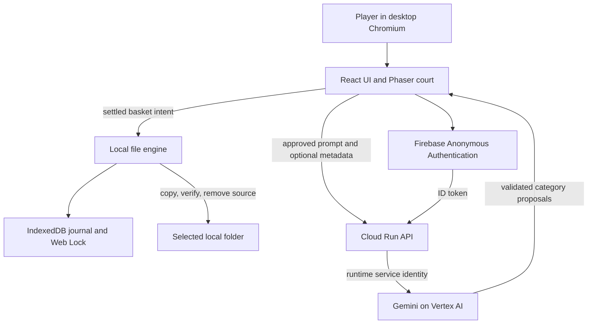

# SlamSort architecture

## Ownership and boundaries

React owns file queues, round snapshots, timer pause reasons, scoring and transitions. Phaser renders the court and emits intentions. Pure physics and correction-window modules are tested independently. The serial `FileEngine` alone mutates local files; Gemini cannot perform file operations.

A settled basket writes an IndexedDB intent, chooses a collision-safe destination, copies and closes the file, verifies every byte in bounded chunks, rechecks both handles, and removes the source only after verification. Completion is journaled before points are awarded. Undo uses the same verification boundary. External-process races are still possible because browser filesystem APIs do not provide atomic compare-and-delete; uncertain operations block play pending recovery.

## Preparation and hierarchy

The starting buffer prepares four local previews (all files if fewer than four) with at most two concurrent reads. Phaser and PDF rendering load lazily. Each round fixes its 1–5 destination hoops. Child plans are cached and serialized while the player sorts; with explicit filename consent they use sampled actual bin membership. Final membership can refresh the plan before entry. Completed rounds progress breadth-first through populated session destinations. Singletons, unchanged groups and Duplicates terminate progression.

## Google Cloud

Both the static website and Node HTTP API run on Cloud Run in `asia-south1`. The API accesses Gemini through Vertex AI with its runtime service account, without service-account key files. The client obtains Firebase Anonymous Authentication only for an AI action; the API verifies the token's signature, issuer and audience. Auth project `slamsort-245f9` is distinct from Cloud Run/Vertex project `slamsort`.

Public requests pass exact-origin CORS, token validation, request-size limits, schema validation, concurrency and per-user/per-instance rate limits. Model outputs must contain 1–5 safe unique folder names. AI metadata requires explicit consent and excludes file contents, paths and sensitive filenames. Individual hints separately review any approved excerpt. Provider errors are sanitized and payloads/tokens are not logged.

Local AI is an explicit separate mode with loopback origin and ephemeral bootstrap-token checks. Production cannot enable local and public modes simultaneously. The default API works in health-only mode without credentials. See [deployment](deployment.md), [security](../SECURITY.md) and [evaluation evidence](evaluation.md).

## Supported scope

The prototype supports real local moves, verified undo, recovery inspection, manual bins, Gemini plans/hints, a retained duplicate destination and automatic levels. It does not implement automatic duplicate discovery, recursive arbitrary-folder cleanup, cloud file storage, billing, analytics, worker hashing or journal pruning. Native folder access needs desktop Chromium, HTTPS/localhost and a user gesture. The demo remains available without folder access.
